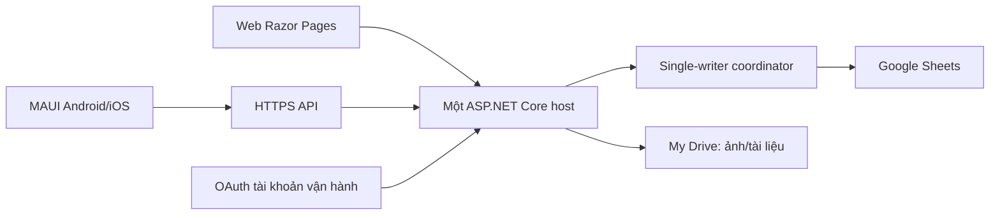

# ADR-001 — Backend chung, Google Sheets/Drive, web và mobile

- Status: ACCEPTED
- Date: 2026-10-06; amended 2026-10-07 for least-privilege Google access
- Decision owner: Nguyễn Thanh Hiệp
- Scope: kiến trúc ứng dụng và môi trường demo; nhà cung cấp host/domain và tài nguyên Google cụ thể vẫn chưa được chọn.

## Bối cảnh

Sản phẩm cần có web và ứng dụng Android/iOS riêng, cùng sử dụng Google Sheets làm
CSDL nghiệp vụ và Google Drive lưu ảnh/DOCX/PDF. Hệ thống phải dùng được trong
công ty và từ Internet. Sheets không cung cấp transaction, unique constraint hoặc
distributed lock tương đương CSDL giao dịch; vì vậy số instance ghi là một ràng
buộc kiến trúc, không chỉ là lựa chọn triển khai.

## Quyết định

- Backend/API dùng ASP.NET Core trên .NET 10. Backend là nơi duy nhất thực thi
  nghiệp vụ, validation, phân quyền và thao tác Google.
- Web dùng Razor Pages, cùng host ASP.NET Core với API. Mobile dùng .NET MAUI với
  hai target riêng Android và iOS; app chỉ gọi API, không gọi Google trực tiếp.
- Web/mobile dùng chung API, rules và authorization. Tài khoản đăng nhập ứng dụng
  do ứng dụng quản lý, hoàn toàn tách với Google OAuth của backend.
- Google Sheets là persistence nghiệp vụ duy nhất. Ảnh và tài liệu nằm trong một
  thư mục My Drive của tài khoản vận hành công ty. Không thêm SQL/SQLite làm CSDL
  thay thế hoặc nguồn dữ liệu ngầm.
- Backend kết nối Google bằng OAuth 2.0 của tài khoản vận hành công ty. Client
  secret, refresh token và credential chỉ tồn tại ngoài repo và không được nhúng
  vào web/mobile.
- OAuth integration chỉ request `https://www.googleapis.com/auth/drive.file` cho
  cả Sheets API và Drive API. Không dùng `spreadsheets`, `drive` hay fallback sang
  scope rộng khi lỗi; runtime fail-closed nếu token response không đúng duy nhất
  `drive.file`.
- Resource mới được app tạo qua lệnh provisioning chủ động. Resource có sẵn phải
  được người vận hành chọn qua Google Picker; ID chỉ là tham chiếu cấu hình, không
  phải grant. Chọn folder không cấp quyền cho file con có sẵn; file đó cần Picker
  riêng trong flow nghiệp vụ phù hợp.
- Demo chạy đúng một backend instance. Mọi lệnh ghi đi qua
  `ISingleWriterCoordinator`; scaffold hiện dùng lock trong tiến trình. Không
  scale-out bằng nhiều instance có lock RAM độc lập.
- Endpoint người dùng và kết nối backend–Google đều dùng HTTPS ở môi trường sử
  dụng. Host public phải đặt TLS/reverse proxy và cấu hình forwarded headers/host
  allow-list phù hợp khi nhà cung cấp được chọn.
- Nhà cung cấp hosting, domain, Google Cloud project, OAuth client,
  `spreadsheetId` và `folderId` chưa được xác lập. TASK-003 không tự chọn dịch
  vụ trả phí, tạo tài nguyên Google hay deploy public.

## Hệ quả và giới hạn

- Lock trong tiến trình chỉ đúng khi có một backend instance. Scale-out, active-
  active hoặc nhiều tiến trình ghi cần ADR mới và coordinator dùng chung.
- Không coi Sheets có CAS/transaction nhiều request. TASK-004 phải PoC
  idempotency, version check, batch, retry giới hạn và reconcile trạng thái chưa
  biết sau timeout/429.
- Sheets và Drive không có transaction chung. Upload phải có operation state và
  reconciliation để xử lý file mồ côi hoặc metadata chưa commit.
- Console Data Access, request scope trong code và OAuth grant/token là ba lớp
  khác nhau. Đổi scope ở Console không sửa request code hoặc thu hồi token rộng
  đã phát hành; khi thu hẹp phải sửa code, xóa scope rộng, revoke grant/token và
  consent lại.
- Không cấp quyền editor Sheet cho người dùng ứng dụng. Nếu vận hành sửa Sheet
  thủ công, phải dừng writer, kiểm tra và reload trước khi mở ghi lại.
- Identity/app session sẽ do backend quản lý. Web dùng cookie HttpOnly và
  anti-forgery; mobile dùng token ứng dụng và secure storage. Đây không phải Google
  sign-in cho người dùng.
- Local đã có HTTPS launch profile. Việc phục vụ Internet chỉ được xem là hoàn
  thành sau khi host/domain/TLS thực tế được cấu hình và kiểm chứng.
- Build iOS trên Windows chỉ chứng minh project compile. Chỉ báo kiểm thử iOS
  thành công sau khi xác minh Mac, Xcode, signing và chạy trên iPhone/simulator
  phù hợp. Android cũng cần bằng chứng thiết bị/emulator riêng.

## Trạng thái triển khai tại TASK-003

- Đã tạo solution .NET 10 gồm Application, adapter Google, ASP.NET Core
  Razor/API, MAUI Android/iOS và project test.
- Đã có interface/adapter readiness và lock single-writer trong tiến trình.
  Adapter chưa gọi Google API và luôn báo chưa có live connection.
- Chưa triển khai auth, CRUD, import, báo cáo hoặc chức năng của TASK-004–TASK-014.
- Cấu hình và tên secret được mô tả tại [CONFIGURATION](../CONFIGURATION.md).

## Phương án không chọn

- React/React Native hoặc framework khác: không chọn vì người dùng đã xác lập
  Razor Pages và .NET MAUI.
- SQL/SQLite: không chọn làm persistence vì trái quyết định Google Sheets.
- Mobile truy cập Google trực tiếp: không chọn vì làm lộ credential và phân tán
  rules/quyền.
- Nhiều backend instance ở demo: không chọn vì phá vỡ single-writer khi chỉ dùng
  lock trong tiến trình.

## Việc còn mở

1. Tài khoản Google vận hành, Google Cloud project/OAuth client, Data Access chỉ
   `drive.file`, spreadsheet/folder dev qua provisioning hoặc Picker và live
   evidence file được cấp quyền/không được cấp quyền.
2. Nhà cung cấp hosting, domain, TLS/reverse proxy và cách kết nối mạng công
   ty/Internet.
3. Rule cấp mã demo/người xác nhận; Android device và thông tin Mac/Xcode/signing/
   iPhone/OS để kiểm chứng từng nền tảng.
