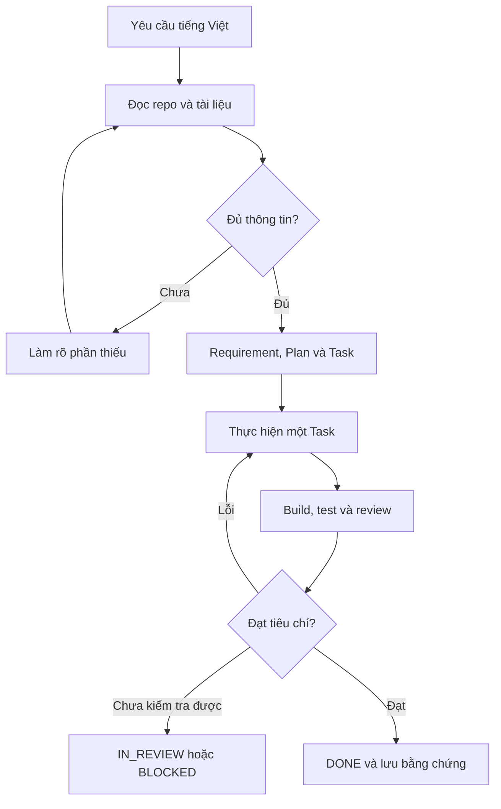

# Quy trình làm việc

## Anh Hiệp làm gì, AI làm gì?
Anh nêu mục tiêu, cung cấp biểu mẫu/quy tắc và thử kết quả. AI đọc repo, chuyển lời nói thành Requirement/Task, chọn skill, code, kiểm thử và ghi bằng chứng.
Người dùng không cần nhớ plugin hoặc tự soạn đúng template.

## Chọn mức công việc
| Công việc | Tài liệu tối thiểu | Điều phối |
|---|---|---|
| Sửa nhỏ, yêu cầu rõ | Một Task ngắn; cập nhật Requirement nếu hành vi thay đổi | Skill kỹ thuật phù hợp |
| Feature nhiều bước | Requirement + Plan + các Task | Một workflow chính, conductor nếu phù hợp |
| Module nhiều lớp | Spec/Plan + ADR khi cần + Task theo lát chức năng | ship-mate hoặc workflow tương đương nếu phù hợp |
| Nghiên cứu/tư vấn | Ghi kết luận nếu được yêu cầu | Không tự code |

## Mỗi vòng thực thi
1. Đọc trạng thái hiện tại, tìm Requirement liên quan và kiểm tra thay đổi đang có.
2. Tạo Task có phạm vi và acceptance criteria kiểm tra được; không chỉ ghi “hoạt động tốt”.
3. Với phần nghiệp vụ mới, ghi nguồn, quy tắc và ví dụ hợp lệ/không hợp lệ; hỏi điểm quyết định chưa rõ.
4. Chọn ít skill cần thiết. Đọc skill thật; không suy diễn từ tên plugin. Nếu conductor/ship-mate sinh tài liệu vào vị trí riêng, chọn một bản authoritative và đặt link từ docs; không giữ hai spec mâu thuẫn.
5. Implement phần nhỏ đủ dùng và dễ kiểm thử. Không tạo tất cả module cùng lúc.
6. Chạy kiểm tra phù hợp từ COMMANDS.md, ghi kết quả; thất bại thì sửa đúng phạm vi rồi chạy lại phần cần thiết.
7. Review code/diff, đối chiếu Requirement → AC → test evidence. Nếu self-review thì ghi rõ self-review.
8. Cập nhật INDEX, trạng thái Task và bối cảnh; hướng dẫn người dùng thử tính năng.

## Điều kiện để bắt đầu code nghiệp vụ
- Phạm vi demo và một chức năng đầu tiên đã rõ.
- Stack/môi trường dev được xác lập hoặc đã có trong repo.
- Các quyết định ảnh hưởng chức năng đó đã đủ, có dữ liệu mẫu làm sạch và tiêu chí nghiệm thu.
- Lệnh build/test đã biết, hoặc bootstrap công cụ có Task riêng.

## Tiếp tục phiên khác
AI đọc INDEX, Task đang IN_PROGRESS/IN_REVIEW/BLOCKED, PROJECT-CONTEXT và git diff liên quan. Tiếp tục từ checkpoint và bằng chứng mới nhất, không làm lại từ đầu hay tin toàn bộ lịch sử chat.
